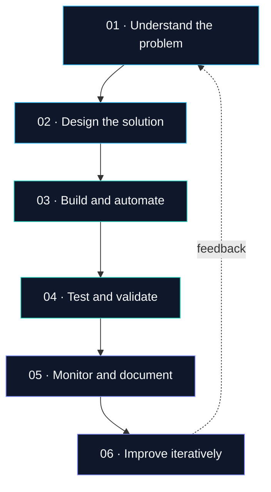

<!--
GitHub Profile README for dilshadkhann
Layout guide:
- Center alignment is reserved for the hero, badges, and visual analytics.
- Main content uses one consistent left-aligned column.
- Tables use consistent header and column alignment.
- Planned projects are clearly labeled as planned, not completed.
-->

**Cloud-minded. Automation-driven. Always learning.**

[About](#about-me) · [Technology](#technology-stack) · [Experience](#professional-experience) · [Projects](#portfolio-projects) · [Analytics](#github-analytics) · [Contact](#contact)

---

## About Me

I'm **Dilshad Naushad Khan**, a technology professional based in the **Mumbai Metropolitan Region, India**. I work at **Wipro as a DevOps Engineer (Scholar Trainee)** and am interested in cloud infrastructure, deployment automation, platform operations, and Generative AI.

My path into technology began with design, web development, and programming. That background helps me consider both how systems work and how their design, documentation, and user experience can be improved.

### Current Focus

| Area | Focus |
|:---|:---|
| **Cloud platforms** | AWS and Microsoft Azure; Google Cloud learning and certification exposure |
| **DevOps foundations** | Linux, Git, deployment workflows, containers, and operational practices |
| **Reliability** | Monitoring, troubleshooting, documentation, and repeatable processes |
| **AI and data** | Generative AI, Python-based AI applications, and data science learning |
| **Earlier experience** | Programming, web development, graphic design, and digital communication |

> **Goal:** Build systems that are understandable, repeatable, observable, secure by design, and easier to operate.

---

## Technology Stack

*The tools below reflect my technical background, current focus, and learning interests. They do not imply equal depth of experience with every technology.*

### Cloud, Infrastructure & Operations

| Category | Technologies and topics |
|:---|:---|
| **AWS services** | EC2, VPC, IAM, S3, CloudWatch, Route 53, Elastic Load Balancing, Auto Scaling, Lambda |
| **Infrastructure as Code** | Terraform and AWS CloudFormation |
| **Containers** | Docker; exploring ECS, EKS, and Kubernetes deployment patterns |
| **Cloud fundamentals** | Microsoft Azure and Google Cloud concepts |
| **Operations** | Linux, logs, monitoring, troubleshooting, documentation, and cost awareness |

### Programming, Development & Data

| Category | Background |
|:---|:---|
| **Languages** | Python, C++, C#, Java, JavaScript, HTML, and CSS |
| **Frameworks and tools** | .NET fundamentals, Flask, XML-based Android application development |
| **Data exposure** | MongoDB and application-level data handling |
| **Creative strengths** | Graphic design, posters, infographics, content writing, and social media |

### AI & Data Exploration

- Generative AI concepts and Python-based AI applications.
- Diffusion-model learning and practical AI experimentation.
- Data science fundamentals and responsible use of data.

### Certifications & Continuous Learning

My LinkedIn profile lists **36 licenses and certifications**, spanning cloud platforms, AI, and Generative AI. Examples provided include:

- **Advanced Python Projects: Build AI Applications** — LinkedIn Learning, September 2024.
- **Hands-On Generative AI with Diffusion Models: Building Real-World Applications** — LinkedIn Learning, September 2024.
- **Microsoft Generative AI Essentials** and cloud fundamentals learning.
---
### Project Quality Checklist

Every published project should aim to include:

- [ ] A clear problem statement and scope.
- [ ] An architecture diagram or workflow.
- [ ] Reproducible setup and usage instructions.
- [ ] Validation steps and evidence that the build works.
- [ ] Security notes and known limitations.
- [ ] Cost considerations and teardown steps for cloud resources.

---

## Engineering Workflow

| Principle | How I apply it |
|:---|:---|
| **Design for operations** | Consider monitoring, recovery, and maintenance—not only deployment. |
| **Automate repeatable work** | Make changes reviewable and reduce manual drift. |
| **Build with security in mind** | Prefer least privilege, safe configuration, and limited exposure. |
| **Document decisions** | Record trade-offs, setup, verification, and cleanup. |
| **Learn in public** | Publish labs, explain what changed, and share lessons learned. |

---

## GitHub Analytics

> **Analytics note:** These cards use third-party services and may occasionally be unavailable. Language statistics reflect public repository content and are not a complete measure of skill. New or empty repositories may show limited activity.

---

## Learning Roadmap

- [ ] Publish an AWS infrastructure lab with an architecture diagram.
- [ ] Add an Infrastructure as Code example with validation and teardown instructions.
- [ ] Build a container deployment with a documented CI/CD flow.
- [ ] Publish an observability dashboard and incident runbook.
- [ ] Share a Python / Generative AI project with evaluation notes.

*These are portfolio goals, not claims that the work is already complete.*

---

## Contact

I'm interested in connecting with people working across **DevOps, cloud engineering, platform operations, automation, cloud security, and applied AI**.

<!-- Add your actual LinkedIn profile URL before enabling this badge. -->
<!--  -->

**Build deliberately · Automate intelligently · Operate reliably**

